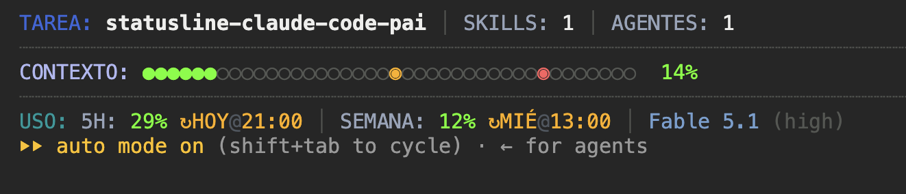

# claude-code-statusline

Statusline para [Claude Code](https://code.claude.com) en español, inspirada en la de PAI: tres filas con lo esencial de la sesión y nada más.



## Qué muestra

| Fila | Dato | De dónde sale |
|---|---|---|
| **TAREA** | Nombre de la sesión (`/rename`, `--name` o el título que genera Claude Code). Si no hay, la carpeta actual. | `session_name`, `workspace.current_dir` |
| **SKILLS / AGENTES** | Cuántos skills y subagentes distintos entraron al contexto en esta sesión. | Se cuentan en el transcript (`transcript_path`) |
| **CONTEXTO** | Barra de 40 celdas con semáforo: verde < 50 %, ámbar 50–79 %, rojo ≥ 80 %. Las marcas `◉` señalan los umbrales. | `context_window.used_percentage` |
| **USO** | Consumo de la ventana de 5 h y de la semana, con hora de reinicio (`HOY@15:00`, `MIÉ@13:00`). | `rate_limits.five_hour`, `rate_limits.seven_day` |
| **Modelo (effort)** | Modelo en uso y nivel de esfuerzo entre paréntesis. | `model.display_name`, `effort.level` |

## Requisitos

- Claude Code 2.1 o superior.
- `bash` y [`jq`](https://jqlang.github.io/jq/) (`brew install jq`).
- macOS o Linux. Terminal con soporte de color de 24 bits (iTerm2, WezTerm, Kitty, Ghostty, Terminal.app moderno).

## Instalación

### Opción 1: pídeselo a Claude Code

Abre Claude Code y pega este prompt:

```text
Instala esta statusline en mi Claude Code:

1. Verifica que jq esté instalado; si no, instálalo con brew.
2. Descarga https://raw.githubusercontent.com/emmanuelbarturen/claude-code-statusline/main/statusline.sh
   en ~/.claude/statusline.sh y dale permiso de ejecución.
3. Haz una copia de seguridad de ~/.claude/settings.json y añade (sin borrar lo que ya hay):
   "statusLine": { "type": "command", "command": "~/.claude/statusline.sh" }
4. Prueba el script con una entrada simulada:
   echo '{"model":{"display_name":"Opus"},"session_name":"prueba","context_window":{"used_percentage":25}}' | ~/.claude/statusline.sh
5. Muéstrame el resultado y confirma que settings.json sigue siendo JSON válido.
```

La statusline aparece al terminar ese turno o en la siguiente sesión.

### Opción 2: manual

```bash
git clone https://github.com/emmanuelbarturen/claude-code-statusline.git
cd claude-code-statusline
./install.sh
```

El instalador copia `statusline.sh` a `~/.claude/`, hace una copia de seguridad de `~/.claude/settings.json` y añade:

```json
"statusLine": { "type": "command", "command": "~/.claude/statusline.sh" }
```

Reinicia Claude Code y aparece. Para probarla sin abrir Claude Code:

```bash
./preview.sh
```

## Personalización

Todos los colores están al inicio de `statusline.sh`, en el bloque `# ---------- colores ----------`. Cada variable es una secuencia ANSI; las de 24 bits tienen la forma `\e[38;2;R;G;Bm`.

Otros ajustes rápidos:

- **Ancho de la barra**: `cells=40` dentro de la función `bar`.
- **Umbrales del semáforo**: la función `level_color` y las marcas `i == 20` / `i == 32` en `bar`.
- **Idioma de los días**: el array `names` en `fmt_reset`.

## Limitaciones

- La fila **USO** solo se llena en cuentas Pro o Max, que son las que reciben `rate_limits`. En otras cuentas muestra `USO: —`.
- **SKILLS** cuenta los skills invocados mediante la herramienta `Skill`. Un skill que el usuario lanza tecleando `/nombre` no se distingue en el transcript de un comando interno, así que no se cuenta.

## Licencia

MIT.
